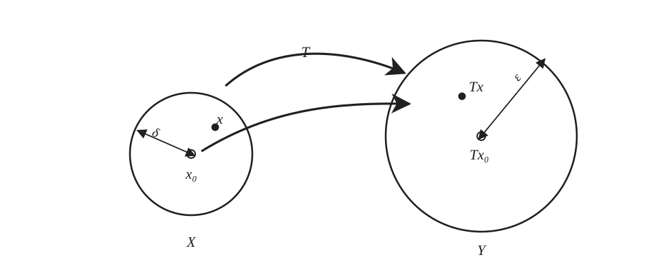
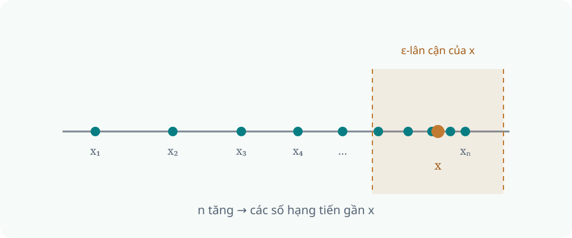
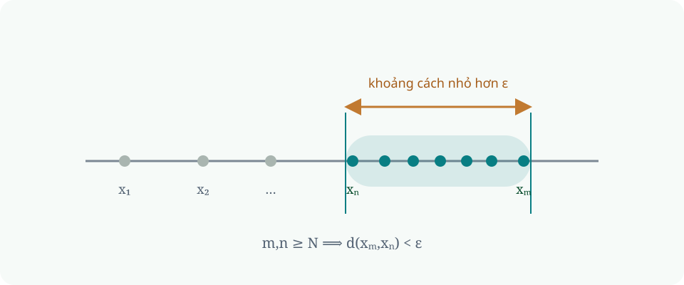

## Lời mở đầu {#chapter-opening .chapter-opening-slide}

::: {.chapter-quote-card}

CHƯƠNG 1

### Không gian metric

> Điều anh nhận ra là khoảng cách hai chúng mình

— Hành trình của kẻ khờ

:::

## 1.1 Không gian metric {#sec-ch01-01}

::: {#def-ch01-src-01 .def- name="Không gian metric, metric"}

*Không gian metric* là một cặp $(X,d)$, trong đó $X$ là một tập hợp và $d$ là một metric trên $X$ (hay hàm khoảng cách trên $X$), tức là một hàm xác định trên $X \times X$ thỏa mãn với mọi $x,y,z \in X$:

**(M1)** $d$ nhận giá trị thực, hữu hạn và không âm;

**(M2)** $d(x,y)=0$ khi và chỉ khi $x=y$;

**(M3)** *(Symmetry)* $d(x,y)=d(y,x)$;

**(M4)** *(Triangle inequality)* $d(x,z)\leq d(x,y)+d(y,z)$.

:::
$X$ thường được gọi là tập nền, tập cơ sở (underlying set). 

## Ví dụ {#sec-ch01-01-02}

Ở đây có một vài khoảng cách thú vị mọi người có thể sẽ gặp như

::: {#example-ch01-src-01 .example-}

**Đường thẳng thực $\mathbb{R}$:** $d(x,y)=|x-y|$\
**Mặt phẳng Euclid $\mathbb{R}^2$:** $d(x,y)=\sqrt{(x_1-y_1)^2+(x_2-y_2)^2}$
:::

## Không gian cảm sinh metric {#sec-ch01-01-03}
Một không gian metric là một cặp gồm tập hợp và hàm khoảng cách: $(X, d)$. Một tập con $Y \subset X$ đơn thuần chỉ là một tập hợp, bản thân nó chưa phải là không gian metric.Hàm $d$ ban đầu nhận đầu vào từ $X \times X$:$$d: X \times X \longrightarrow [0, +\infty)$$Nếu muốn đo khoảng cách trên $Y$, ta cần một hàm xác định trên $Y \times Y$:$$\widetilde{d} = d\vert{}_{Y \times Y}: Y \times Y \longrightarrow [0, +\infty)$$

$\widetilde{d}$ được gọi là metric **cảm sinh (induced)** trên $Y$ bởi $d$

## Hình cầu, lân cận, tập mở và tập đóng {#sec-ch01-02}

::: {#def-ch01-src-02 .def- name="Hình cầu và mặt cầu"}

Cho điểm $x_0 \in X$ và số thực $r > 0$, ta định nghĩa ba tập hợp:

1.  $B(x_0, r) = \{x \in X \mid d(x, x_0) < r\}$ **(Hình cầu mở)**

2.  $\widetilde{B}(x_0, r) = \{x \in X \mid d(x, x_0) \leq r\}$ **(Hình cầu đóng)**

3.  $S(x_0, r) = \{x \in X \mid d(x, x_0) = r\}$ **(Mặt cầu)**

Trong cả ba trường hợp, $x_0$ được gọi là tâm và $r$ là bán kính.

:::

Dễ nhìn thấy $S(x_0, r)=\widetilde{B}(x_0, r)-B(x_0, r)$

Cho không gian metric $(X, d)$, một điểm $x_0 \in X$ và số thực $\varepsilon > 0$. Hình cầu mở tâm $x_0$ bán kính $\varepsilon$: $$B(x_0, \varepsilon) := \{x \in X : d(x, x_0) < \varepsilon\}$$ được gọi là một **$\varepsilon$-lân cận** của $x_0$. Một tập con $N \subset X$ được gọi là một **lân cận** của $x_0$ nếu tồn tại $\varepsilon > 0$ sao cho $B(x_0, \varepsilon) \subset N$.

## Tập mở và tập đóng (định nghĩa) {#sec-ch01-02-open-closed}

::: {#def-ch01-src-03 .def- name="Tập mở, tập đóng"}

Một tập con $M$ của không gian metric $X$ được gọi là *mở* nếu nó chứa một hình cầu quanh mỗi điểm của mình. Tập con $K$ của $X$ được gọi là *đóng* nếu phần bù của nó trong $X$ là tập mở, nghĩa là $K^C = X-K$ mở.

:::

Chúng ta có thể phân chia bằng công thức như sau:

Tập mở:

$$\boxed{
\forall x\in M,\ \exists r>0,\ \forall y\in X:
d(x,y)<r\implies y\in M.}$$

Tập đóng:

$$\boxed{
\forall x\in X\setminus K,\ \exists r>0,\ \forall y\in X:
d(x,y)<r\implies y\notin K.}$$

## Tính chất {#sec-ch01-02-operations}

Chúng ta có thể thu được các tính chất như sau:

::: {.center}
      **Phép toán**             **Tập mở**                **Tập đóng**
  ---------------------- ------------------------- ---------------------------
   $\varnothing$ và $X$             Mở                        Đóng
       Hợp hữu hạn                  Mở                        Đóng
        Hợp tùy ý                   Mở              **Không nhất thiết đóng**
       Giao hữu hạn                 Mở                        Đóng
        Giao tùy ý        **Không nhất thiết mở**             Đóng

:::
## Tính liên tục của ánh xạ {#sec-ch01-02-continuity}

::: {#def-ch01-src-06 .def- name="Ánh xạ liên tục"}

Cho $X=(X,d)$ và $Y=(Y,\widetilde{d})$ là các không gian metric. Ánh xạ $T: X \to Y$ được gọi là *liên tục tại điểm* $x_0 \in X$ nếu với mọi $\varepsilon > 0$, tồn tại $\delta > 0$ sao cho $$\widetilde{d}(Tx,Tx_0)<\varepsilon \quad \text{với mọi } x \text{ thỏa mãn} \quad d(x,x_0)<\delta$$ T được gọi là *liên tục* nếu liên tục tại mọi điểm của $X$.

:::

Lân cận bán kính $\delta$ quanh $x_0$ được ánh xạ vào lân cận bán kính $\varepsilon$ quanh $T(x_0)$.

## Định lý tính liên tục {#sec-ch01-02-thm}

::: {#thm-ch01-src-01 .thm- name="Ánh xạ liên tục"}

Ánh xạ $T$ từ không gian metric $X$ vào không gian metric $Y$ liên tục khi và chỉ khi ảnh ngược của mọi tập mở trong $Y$ là tập mở trong $X$.

:::

<a href="../proof/proof-ch01-continuity.html" target="_blank" rel="noopener">Chứng minh</a>

## Khả ly và tính trù mật {#sec-ch01-02-density}

Điểm $x_0\in X$ được gọi là **điểm tụ (accumulation point)** của M nếu mỗi lân cận của $x_0$ chứa ít nhất 1 điểm $y \in M$ cách $x_0$.

**Bao đóng (closure)** của một tập M là tập hợp gồm tất cả các điểm thuộc tập ban đầu và tất cả các điểm tụ của nó và được kí hiệu là $\overline{M}$. 

:::{callout-note}
Bao đóng $\overline{M}$ cũng là *tập đóng nhỏ nhất* chứa M.
:::

::: {#def-ch01-src-04 .def- name="Tập trù mật, không gian khả ly"}

Tập con $M$ của không gian metric $X$ được gọi là *tập trù mật (dense set)* trong $X$ nếu $\overline{M}=X$. 

Không gian $X$ được gọi là *khả ly (separable)* nếu nó có một tập con đếm được trù mật.

:::

## Định lý {#sec-ch01-02-theorem}

::: {#def-ch01-open-closed .def- name="Tập mở và tập đóng"}

Tập $U\subseteq X$ mở nếu với mỗi $x\in U$ tồn tại $r>0$ sao cho $B(x,r)\subseteq U$. Tập $F$ đóng nếu phần bù $X\setminus F$ mở.

:::

::: {#thm-ch01-01 .thm-}
Hợp tùy ý các tập mở là mở; giao hữu hạn các tập mở là mở. Giao
tùy ý các tập đóng là đóng; hợp hữu hạn các tập đóng là đóng.

:::

## Sự hội tụ của dãy {#sec-ch01-03}

::: {#def-ch01-src-05 .def- name="Sự hội tụ của dãy, giới hạn"}

Dãy $(x_n)$ trong không gian metric $X=(X,d)$ được gọi là *hội tụ* nếu tồn tại $x \in X$ sao cho $$\lim_{n\to \infty}d(x_n,x)=0$$ $x$ được gọi là *giới hạn* của $(x_n)$ và ta viết $$\lim_{n\to \infty}x_n=x \qquad \text{hoặc} \qquad x_n \longrightarrow x.$$ Nếu $(x_n)$ không hội tụ thì được gọi là *phân kỳ*.

:::

::: {#thm-ch01-02 .thm- name="Tính duy nhất của giới hạn"}
Trong không gian metric, một dãy
không thể hội tụ đến hai điểm khác nhau.

:::

## Minh họa hội tụ của dãy {#sec-ch01-03-visual}

Các số hạng tiến gần tùy ý đến $x$: với mỗi $\varepsilon>0$, từ một chỉ số đủ lớn trở đi, mọi $x_n$ đều nằm trong $\varepsilon$-lân cận của $x$. Minh họa trên trục số thực.

## Dãy Cauchy và không gian metric đầy đủ {#sec-ch01-04}

Một dãy $(x_n)$ được gọi là Cauchy nếu với mọi $\varepsilon>0$ tồn tại $N$ sao cho $d(x_m,x_n)<\varepsilon$ với mọi $m,n\ge N$. Không gian metric đầy đủ là không gian trong đó mọi dãy Cauchy đều hội tụ; vì vậy tính đầy đủ bảo đảm các giới hạn cần thiết vẫn nằm trong chính không gian.

::: {#def-ch01-05 .def-}
$(x_n)$ là Cauchy nếu với mọi $\varepsilon>0$ tồn tại $N$ sao
cho $m,n\ge N$ thì $d(x_m,x_n)<\varepsilon$. Không gian metric đầy đủ nếu mọi
dãy Cauchy đều hội tụ trong không gian.

:::

::: {.example-}
Các số hữu tỉ với metric thông thường không đầy đủ: có dãy hữu tỉ Cauchy tiến
đến $\sqrt 2$, nhưng $\sqrt2\notin\mathbb Q$. Không gian thực là phần hoàn
thiện của không gian hữu tỉ.

:::

## Minh họa dãy Cauchy {#sec-ch01-04-visual}

Điều kiện Cauchy yêu cầu các số hạng ở đủ xa trong dãy gần nhau từng đôi một; không cần biết trước giới hạn là điểm nào. Minh họa trên $\mathbb{R}$.

## Phép đồng phôi và đẳng cự {#sec-ch01-06}

Một song ánh liên tục có ánh xạ ngược liên tục được gọi là phép đồng phôi; nó bảo toàn cấu trúc tôpô nhưng không nhất thiết bảo toàn khoảng cách. Đẳng cự là ánh xạ $T$ thỏa mãn $d_Y(Tx,Ty)=d_X(x,y)$ với mọi $x,y$, nên bảo toàn chính xác khoảng cách.

::: {#def-ch01-07 .def-}
Đồng phôi là song ánh liên tục có ánh xạ ngược liên tục.
Đẳng cự $T$ thỏa $d_Y(Tx,Ty)=d_X(x,y)$ với mọi $x,y$.

:::

## Phép hoàn thiện không gian metric {#sec-ch01-07}

Mọi không gian metric đều có thể được nhúng đẳng cự như một tập con trù mật vào một không gian metric đầy đủ, gọi là phần hoàn thiện. Phần hoàn thiện là duy nhất sai khác một đẳng cự bảo toàn các điểm của không gian ban đầu.

::: {#thm-ch01-04 .thm- name="Hoàn thiện"}
Mọi không gian metric có một phần hoàn thiện đầy đủ
mà không gian ban đầu nhúng đẳng cự như một tập con trù mật. Phần hoàn thiện
là duy nhất sai khác một đẳng cự bảo toàn các điểm ban đầu.

:::
